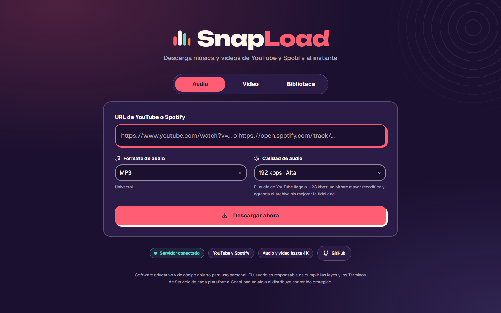

<div align="center">
  
  
  # SnapLoad
  
  ### Download music and videos from YouTube/Spotify easily
  
  [](https://www.gnu.org/licenses/gpl-3.0)
  [](https://www.docker.com/)
  [](https://www.python.org/)
  [](https://nextjs.org/)
  
  **English** | [Español](../README.md)
</div>

---

## 🚀 Quick Install (Recommended)

**One command to install and run SnapLoad:**

```bash
curl -fsSL https://raw.githubusercontent.com/pabrax/SnapLoad/main/install.sh | bash
```

Or manually:

```bash
git clone --recursive https://github.com/pabrax/SnapLoad.git
cd SnapLoad
docker-compose up -d
```

**Access:**
- 🎨 Frontend: http://localhost:9013
- ⚙️ Backend API: http://localhost:9020
- 📚 API Docs: http://localhost:9020/docs

---

## 📦 What is SnapLoad?

SnapLoad is a full-stack application that allows you to download music and videos from YouTube and Spotify quickly and easily. Perfect for building your local media library.

### ✨ Features

- 🎵 **YouTube & Spotify Audio** - Download high-quality songs
- 🎬 **YouTube Videos** - Multiple formats and resolutions
- 📋 **Playlist Support** - Download complete playlists
- 🔄 **Smart Cache System** - Avoid duplicate downloads
- 🧹 **Automatic Cleanup** - Automatic disk space management
- 🐳 **Docker Ready** - Simplified deployment
- 🌐 **RESTful API** - Easy integration with other services

---

## 🏗️ Project Structure

This is a monorepo containing two independent projects as Git submodules:

```
SnapLoad/
├── snapLoad-API/          # Backend (FastAPI + Python)
│   ├── app/
│   ├── Dockerfile
│   └── README.md
├── snapLoad-UI/           # Frontend (Next.js + React)
│   ├── src/
│   ├── Dockerfile
│   └── README.md
├── docker-compose.yml     # Full-stack orchestration
├── install.sh            # Automated installation script
└── README.md             # Main documentation (Spanish)
```

### 📁 Individual Repositories

Each component has its own GitHub repository:

- **Backend**: [SnapLoad-API](https://github.com/pabrax/SnapLoad-API)
- **Frontend**: [SnapLoad-UI](https://github.com/pabrax/SnapLoad-UI)

You can clone and work with each one separately if you prefer.

---

## 🛠️ Tech Stack

### Backend
- **FastAPI** - Modern, fast web framework
- **yt-dlp** - YouTube downloader
- **spotdl** - Spotify downloader
- **SQLite** - Embedded database
- **APScheduler** - Scheduled automatic cleanup

### Frontend
- **Next.js 15** - React framework with App Router
- **TypeScript** - Static typing
- **Tailwind CSS** - Modern styling
- **Shadcn/ui** - Elegant UI components

---

## 📖 Detailed Installation

### Option 1: Docker (Recommended)

**Requirements:**
- Docker 20.10+
- Docker Compose 2.0+
- Git

**Steps:**

1. **Clone repository with submodules:**
```bash
git clone --recursive https://github.com/pabrax/SnapLoad.git
cd SnapLoad
```

2. **Configure environment variables (optional):**
```bash
# Backend
cp snapLoad-API/.env.example snapLoad-API/.env
# Edit snapLoad-API/.env if you need customization

# Frontend
cp snapLoad-UI/.env.local.example snapLoad-UI/.env.local
# Edit snapLoad-UI/.env.local if you need customization
```

3. **Start services:**
```bash
docker-compose up -d
```

4. **Verify everything works:**
```bash
docker-compose ps
docker-compose logs -f
```

**Stop services:**
```bash
docker-compose down
```

---

### Option 2: Local Development (without Docker)

**Requirements:**
- Python 3.12+
- Node.js 20+
- pnpm
- uv (Python package manager)
- FFmpeg

**Backend:**
```bash
cd snapLoad-API

# Install dependencies
uv sync

# Copy .env
cp .env.example .env

# Run
uv run uvicorn app.api:app --reload --host 0.0.0.0 --port 8000
```

**Frontend:**
```bash
cd snapLoad-UI

# Install dependencies
pnpm install

# Copy .env
cp .env.local.example .env.local

# Run
pnpm dev
```

---

## 🔧 Configuration

### Backend (`.env`)

```bash
# Cleanup settings
RETENTION_HOURS=3                    # File lifetime
TEMP_RETENTION_HOURS=1               # Temp file lifetime
CLEANUP_CRON="0 * * * *"            # Every hour
TEMP_CLEANUP_CRON="0 */30 * * *"    # Every 30 minutes

# Admin endpoints (development only)
ENABLE_ADMIN_ENDPOINTS=false

# Logs
CLEANUP_LOG_LEVEL=INFO
```

### Frontend (`.env.local`)

```bash
NEXT_PUBLIC_API_URL=http://localhost:8000
```

---

## 📚 API Documentation

Once the backend is running, access:

- **Swagger UI**: http://localhost:8000/docs
- **ReDoc**: http://localhost:8000/redoc

### Main Endpoints

```bash
# Download audio (YouTube/Spotify)
POST /download
{
  "url": "https://youtube.com/watch?v=...",
  "quality": "192",   // kbps (32..320) or "best"; optional
  "format": "mp3"     // mp3 (default), m4a, opus, ogg, flac, wav; optional
}

# Download video (YouTube)
POST /download/video
{
  "url": "https://youtube.com/watch?v=...",
  "format": "mp4",        // webm (default), mp4, mkv, mov, avi
  "resolution": "1080p"   // best (default), 2160p, 1440p, 1080p, 720p, 480p, 360p
}

# Cache lookup / job status
GET /lookup?url=...&type=audio|video&quality=...&format=...&resolution=...
GET /jobs/{job_id}

# Get downloaded file
GET /files/{job_id}/{filename}

# Server status
GET /health
```

---

## 🧹 Automatic Cleanup System

SnapLoad includes an intelligent cleanup system that:

- 🗑️ **Automatically removes old files** based on configuration
- 📊 **Manages disk space** to avoid saturation
- 🔄 **Cleans temp files** every 30 minutes
- 📝 **Logs all operations** in detailed logs

**Default configuration:**
- Downloaded files: **3 hours** retention
- Temporary files: **1 hour** retention
- Automatic cleanup: **every hour**

---

## 🔄 Update SnapLoad

To update to the latest version:

```bash
cd SnapLoad

# Update main repo
git pull

# Update submodules
git submodule update --remote --merge

# Rebuild containers
docker-compose up -d --build
```

---

## 🐛 Troubleshooting

### Services won't start

```bash
# View logs
docker-compose logs -f

# Restart services
docker-compose restart

# Rebuild from scratch
docker-compose down
docker-compose up -d --build
```

### Backend won't connect

1. Verify backend is running: `docker-compose ps`
2. Check logs: `docker-compose logs backend`
3. Verify port 8000 is free: `lsof -i :8000`

### Frontend doesn't show data

1. Check `NEXT_PUBLIC_API_URL` variable in `.env.local`
2. Verify backend responds: `curl http://localhost:8000/health`
3. Check browser console for errors

---

## 🤝 Contributing

Contributions are welcome in any of the repositories:

1. Fork the project you want to improve ([API](https://github.com/pabrax/SnapLoad-API) or [UI](https://github.com/pabrax/SnapLoad-UI))
2. Create a feature branch (`git checkout -b feature/AmazingFeature`)
3. Commit your changes (`git commit -m 'Add some AmazingFeature'`)
4. Push to the branch (`git push origin feature/AmazingFeature`)
5. Open a Pull Request

---

## 📄 License

This project is licensed under GPL-3.0. See `LICENSE` files in each subproject for details.

- [Backend License](../snapLoad-API/LICENSE)
- [Frontend License](../snapLoad-UI/LICENSE)

---

## 👤 Author

**Pablo Ramirez** - [@pabrax](https://github.com/pabrax)

---

## ⚠️ Legal Notice

This tool is for personal and educational use only. Respect YouTube and Spotify terms of service. Do not distribute copyrighted content without permission.

---

<div align="center">
  Made with ❤️ by the open source community
</div>
